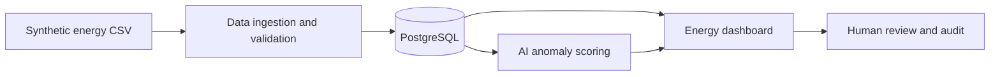

# AI Engineering Lab

Repository belajar mandiri **AI Application Engineering & AI Data Processing** untuk pengembangan kemampuan software engineering dan persiapan dua skema sertifikasi BNSP.

> **Use case aktif: AI Smart Energy Monitoring.** Semua meter, pembacaan kWh, catatan kejadian, dan lokasi site adalah data simulasi. Ini bukan layanan listrik produksi, alat keselamatan, atau sistem billing. Materi belajar mandiri bukan sertifikasi resmi BNSP.

## Project overview

Bangun aplikasi full-stack yang dapat menerima pengukuran meter listrik sintetis, memeriksa kualitas data, menyimpan timeseries, memvisualisasikan konsumsi energi, mendeteksi **kandidat anomali** dan memberi fasilitas peninjauan manusia.



**Modul 1** menggunakan klasifikasi catatan kejadian perangkat (`normal / warning / fault`) sebagai latihan konsep ML. **Modul 11–12** nanti membahas deteksi anomali numerik konsumsi energi; modelnya berbeda.

## Peta pembelajaran 16 modul

| Fase | Minggu | Fokus |
| --- | --- | --- |
| Dasar AI | 01–02 | AI/ML, inferensi, metrik, pemilihan teknologi |
| Proses data | 03–04 | Data ingestion, validasi angka/timestamp/duplikat |
| Software engineering | 05–10 | Struktur data, UX/UI, database, arsitektur, scalability |
| AI engineering | 11–13 | Anomaly detection, integrasi AI, deployment |
| AI operations | 14–15 | Monitoring, maintenance planning, incident recovery |
| Persiapan asesmen | 16 | Evidence mapping, demonstrasi, simulasi |

Setiap modul punya teori, deep dive, worked examples, knowledge check, learning contract, lab-guide, exercises, dan simulasi asesmen.

## Mulai dari sini

- [Pusat materi 16 modul](docs/materials-index.md)
- [Casebook: use case tiap modul](docs/domain-casebook.md)
- [Spesifikasi capstone AI Smart Energy Monitoring](projects/ai-energy-intelligence/README.md)
- [Roadmap belajar](docs/learning-roadmap.md)
- [Metodologi desain pembelajaran](docs/instructional-design.md)
- [Progress tracker](docs/progress-tracker.md)
- [Bukti kompetensi dua skema](certification/evidence-matrix.md)
- [Ketidaksesuaian versi skema dan standar](docs/standards-watch.md)

## Modul 1 — Jalankan demonstrasi

Python 3.11+ tanpa dependency eksternal:

```bash
cd learning/week-01-ai-fundamentals
python -m week01 predict --text "meter melaporkan tegangan stabil normal"
python -m week01 predict --text "sensor offline tidak mengirim data"
python -m week01 evaluate
python -m unittest discover -s tests -v
```

[Modul 1](learning/week-01-ai-fundamentals/README.md) • [Bukti CI dan hasil evaluasi sintetis](learning/week-01-ai-fundamentals/results/verification.md).

## Fase 3 — Audit kualitas materi

- [Audit lengkap 16 modul, temuan dan mitigasi](docs/audits/phase-3-2026-11-09.md)
- [Canonical energy data/API contract](docs/architecture/energy-data-contract.md)
- [Threat model](docs/architecture/threat-model.md)
- [Cross-module engineering gates](docs/architecture/energy-learning-gates.md)
- Setiap minggu punya `energy-case-study.md` dengan skenario domain, penalaran, risiko, dan latihan transfer.

Dokumentasi kini memiliki pemeriksaan struktur, domain, dan contoh numerik di GitHub Actions. **Aplikasi capstone belum selesai dan keamanan production belum diuji.**

## Status implementasi

- **Materi pembelajaran:** 16 modul tersedia.
- **Kode runnable:** baru Modul 1 (text classifier untuk log perangkat sintetis).
- **Capstone numerik:** belum diimplementasikan; materi Week 02–16 merupakan rencana praktik.
- **Uji kompetensi BNSP:** bukan bagian dari repository; kelayakan dan status kompeten ditentukan oleh LSP melalui asesmen resmi.

## Security & privacy

Tidak menggunakan meter fisik, lokasi gedung nyata, data penghuni, data perusahaan, credentials, atau proprietary code. Output AI adalah **bahan review**, bukan perintah melakukan tindakan kelistrikan. Gunakan [Security Policy](SECURITY.md) dan [Contributing Guide](CONTRIBUTING.md).

## License

MIT untuk materi orisinal; semua dependensi/konten pihak ketiga mengikuti lisensinya masing-masing.
