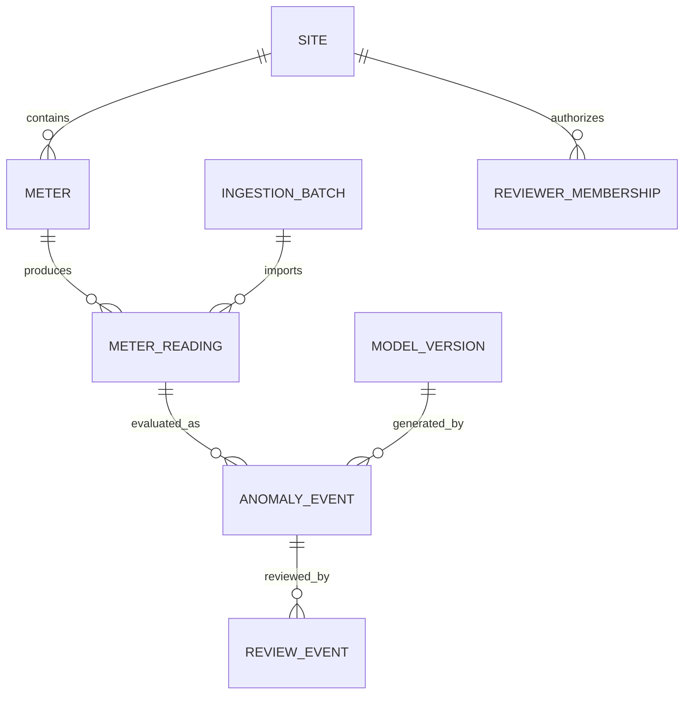

# Canonical Domain Contract — Smart Energy Monitoring

**Version:** curriculum-v3-draft • **Date:** 2026-11-09 • **Scope:** synthetic-only educational system.  
**Authority:** this document is the source of truth for terminology, schemas, API examples and tests in Weeks 02–16. It is not a deployed API or an electricity safety specification.

## 1. Problem and units

We monitor **energy consumed during a fixed sampling interval**. The field `energy_kwh` represents interval consumption; it is neither instantaneous power (`kW`) nor a cumulative meter register.

For each measurement, specify `interval_start_utc` and `interval_minutes=15` in the initial lab. The interval is half-open: `[start, start + 15 minutes)`. Use UTC internally. Display local time only in the UI with timezone conversion, guarding for DST when relevant.

For a **valid** 15-minute interval, average power in kW is:

```text
average_power_kw = energy_kwh / (interval_minutes / 60)
Example: 1.5 kWh over 15 minutes => 1.5 / 0.25 = 6.0 kW average
```

This does **not** imply a fault or physical electrical condition. Voltage/current examples are simulated measurements; one cannot infer kWh or installation safety from V×A alone without phase/power factor/time context.

## 2. Canonical CSV (Version 1)

```csv
site_id,meter_id,source_event_id,interval_start_utc,interval_minutes,energy_kwh,voltage_v,current_a
SITE-A,MTR-001,E-1001,2026-01-01T00:00:00Z,15,1.40,230.0,6.0
SITE-A,MTR-001,E-1002,2026-01-01T00:15:00Z,15,1.48,230.5,6.3
SITE-A,MTR-001,E-1003,2026-01-01T00:30:00Z,15,5.90,228.7,8.2
```

| Field | Rule for teaching project | Security / reliability consequence |
| --- | --- | --- |
| `site_id` | Must match authenticated site scope | **Never** trust client-provided site access without server authorization |
| `meter_id` | Nonempty; belongs to `site_id` | A meter ID may repeat across different sites |
| `source_event_id` | Unique per `(site_id, meter_id)` | Idempotent imports and retry safety |
| `interval_start_utc` | Strict offset-aware ISO 8601, normalized to UTC, aligned to interval | Avoid local-time ambiguities and time leakage |
| `interval_minutes` | Exactly 15 for v1; positive and explicit | Do not compare different durations as equal intervals |
| `energy_kwh` | Finite, nonnegative decimal; recorded per interval | NaN, infinity and negative input must be rejected |
| `voltage_v` | Finite, nonnegative for simulation (optional only if schema allows it) | Range policies based on simulation, **not** electricity safety |
| `current_a` | Finite, nonnegative for simulation (optional only if schema allows it) | Never use to automate physical actuation |

Initial v1 dataset requires all eight columns. If optional fields are introduced later, create explicit schema version and a migration.

## 3. Uniqueness and conflicts

**Identity:** `UNIQUE (site_id, meter_id, source_event_id)`.

If identical input is imported again, it is **skipped**, without changing the accepted measurement. If the same identity arrives with a **different payload**, it is a **conflicting duplicate** and must be rejected/quarantined rather than silently overwritten. A second unique constraint on `(site_id,meter_id,interval_start_utc,interval_minutes)` can enforce one accepted reading per interval, if correction policy supports it; preserve raw/history separately for auditable corrections.

`ingestion_batch` records accepted/rejected/skipped counts and schema version, without storing secrets or real data in logs.

## 4. Logical data model



Anomaly events and review events are **append-only evidence**. Do not rewrite `energy_kwh` when a human changes an anomaly decision.

## 5. Scoring contract

```json
{"reading_id":"synthetic-id","model_version":"baseline-1","anomaly_score":0.93,"flagged":true,"reason_codes":["above_history"],"scoring_status":"scored"}
```

`anomaly_score` is a **project-normalized ranking in [0,1]**, not probability of failure. Raw scores from different models (including Isolation Forest) are not automatically on the same scale; define and version the transformation. `flagged` depends on a documented threshold selected on validation data, not after inspecting held-out test labels. Invalid outputs must not be persisted as successful predictions.

States: `pending_scoring`, `scored`, `scoring_unavailable`, `needs_review`, `reviewed`. Model status and review decision are separate. Review decisions: `confirmed_anomaly`, `expected_variation`, `needs_investigation`. **Missing reading is not zero kWh** and must be shown as an interval gap, not a fabricated point.

Week 01 uses a **different** text classification contract (`normal/warning/fault/abstain`) for simulated device notes. Do not use those text classes as the numeric anomaly-score schema.

## 6. Planned API routes

These are examples, **not implemented endpoints**:

| Method / route | Purpose | Mandatory server control |
| --- | --- | --- |
| `POST /api/v1/import-batches` | Import bounded synthetic CSV file | Authentication, site membership, file/schema validation, idempotency |
| `GET /api/v1/sites/{site_id}/meters/{meter_id}/readings` | Retrieve time-window readings | Validate authenticated access to site and meter; bounded pagination |
| `GET /api/v1/sites/{site_id}/anomaly-events` | List scored candidates | Authorization, pagination, finite filters |
| `POST /api/v1/sites/{site_id}/anomaly-events/{event_id}/reviews` | Submit human decision | Authorized reviewer, optimistic concurrency, audit append-only |
| `GET /health/ready` | Service readiness | Do not leak credentials or private meter details |

**Never** use `POST /meter readings` (contains a space). Do not derive site permissions from model output or arbitrary `site_id` posted by the browser.

## 7. Training/evaluation data contract

Time-series split is chronological. A rolling feature for interval `t` may only use events **before** `t` unless explicitly modeling a post-hoc analysis and labeling it as such. Fit scalers and model on train only; tune thresholds on validation; evaluate held-out test once. For unsupervised models, labels are not implicit: precision/recall require an explicitly defined synthetic anomaly-injection ground truth. Record seed, generator version, class distribution and exclusions.

## 8. Nonfunctional / safety boundaries

- Synthetic site/meter identities; no physical actuation, billing or safety decisions.
- No raw real-world measurements, identifiable location or personal data in Git.
- Site-scoped object authorization on every request; validate server-side, test cross-site IDOR.
- Strict CSV validation, upload size limits, bounded timeouts and retries.
- No `pickle`/`joblib` from untrusted sources; lock dependencies and record model provenance.
- Keep data accepted during AI outage; show `scoring_unavailable` and support human review.

**Related:** [threat model](threat-model.md), [domain casebook](../domain-casebook.md), [capstone requirements](../../projects/ai-energy-intelligence/docs/requirements.md).
