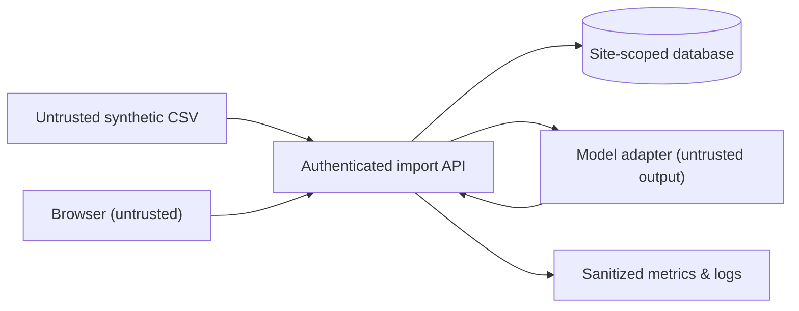

# Threat Model — AI Smart Energy Monitoring

**Scope:** planned full-stack learning capstone; **status:** design-time assessment, not penetration-test certification. All tests run with synthetic fixtures in an isolated environment.

## Assets & boundaries

Assets: site-scoped readings, user roles, review/audit history, model artifacts, credentials, ingestion jobs, availability and usage quotas.

| Risk / entry point | Impact | Required mitigation | Negative verification later |
| --- | --- | --- | --- |
| Upload malicious CSV, oversized input, huge columns | CPU/memory exhaustion, corrupted data | File/batch limits, strict schema, bounded parser; safe exports | Truncated, extra column, >limit, NaN and infinity |
| Replay import with same event ID | Duplicate/falsified time series | Composite uniqueness and payload conflict policy | Exact retry skipped, altered payload rejected |
| Cross-site IDOR / BOLA on meter ID | Information leak or unauthorized review | Authenticated site membership enforced server-side and in query | Site-A cannot read/change Site-B even with guessed ID |
| Forged score/flagged/model_version | Invalid anomaly data | Validate output against versioned schema, no model-derived permissions | NaN, missing version, unknown reason code |
| Feature time leakage | Inflated model metrics | Chronological split and past-only rolling features | Changing future readings cannot alter historical features |
| Prompt injection if LLM introduced | Unsafe outputs, exfiltration | Treat retrieved/input text as data, least privilege, output validation | Malicious instruction not treated as authorized action |
| CSRF/XSS/session issue | Review forgery/account compromise | Secure session/cookie, CSRF strategy, output encoding | Forged cross-origin action, content escaping |
| CI/supply-chain injection | Compromised build/model | Pinned dependencies, narrow workflow permissions, trusted artifacts | Review lockfile/action references; reject untrusted serialized models |
| Resource or inference outage | Lost readings, false normal states | Persist reading independent of scoring; bounded retry and manual review | Fake timeout still retains measurement and audit |
| Logging too much | Exposure of site/record and credentials | Redaction, controlled retention and access to logs | No raw secret/token in trace/error report |
| Electrical safety overclaim | Unsafe operational actions | Human decision required; no actuation API | Test flow provides no switch-off or physical-control command |

## Priorities

**High:** BOLA/cross-site, data corruption, unbounded input/compute, secrets, model-output authorization mistakes.  
**Medium:** drift, retry/queue duplication, observability gaps, misleading UI.  
**Low (for synthetic-only POC):** disclosure of invented identifiers—still model correct behavior to avoid bad production habits.

## Exit criteria for future implementation

- Tests cover unauthorized object access, conflicts, negative schema, outage retention, and backup restore.
- Threats reviewed after selecting actual technology and authentication design.
- Privilege, secrets, dependency/license and artifact provenance reviewed before deployment.
- **No security guarantee is implied by this checklist**; tests and review must be executed later.

[Domain contract](energy-data-contract.md) · [Security policy](../../SECURITY.md).
