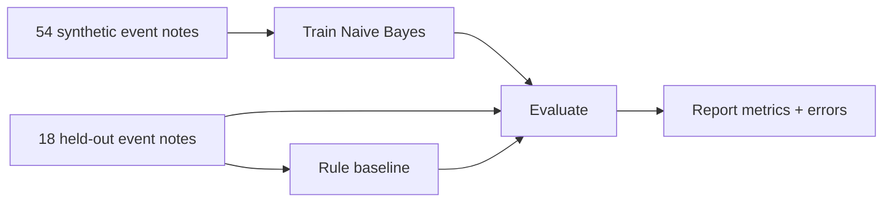

# Teori — AI Engineering Fundamentals untuk Monitoring Energi

## 1. AI, ML, DL, GenAI: apa bedanya?

| Konsep | Definisi singkat | Contoh dalam domain energi |
| --- | --- | --- |
| Artificial Intelligence | Payung metode untuk tugas cerdas | Menandai pembacaan meter yang patut ditinjau |
| Machine Learning | Parameter model dipelajari dari data | Klasifikasi catatan kejadian normal/warning/fault |
| Deep Learning | Bagian ML menggunakan neural networks berlapis | Model deret waktu yang kompleks, bila data memadai |
| Generative AI | Menghasilkan konten baru | Menyusun penjelasan tren untuk dibaca analis |
| LLM | Model bahasa skala besar | Ringkasan laporan teknis, **bukan** penentu tunggal anomali |
| Rule-based | Logika eksplisit pengembang | Jika catatan memuat `offline`, tandai fault untuk diperiksa |

Tidak setiap masalah AI memerlukan LLM. Baseline statistik/aturan sering lebih murah, dapat diaudit, dan cocok untuk memulai.

## 2. Training, inference, evaluation dan deployment

1. **Training:** Naive Bayes membaca 54 catatan perangkat sintetis yang sudah diberi label dan menghitung distribusi kata.
2. **Inference:** menerima catatan baru, melakukan tokenisasi, menghitung skor tiap kelas lalu menghasilkan label atau `abstain`.
3. **Evaluation:** menghitung accuracy, precision, recall, macro F1, dan confusion matrix pada 18 catatan held-out.
4. **Deployment:** memasang model di lingkungan aplikasi, mengontrol akses, mencatat observability dan menangani kegagalan. **Belum dilakukan di Modul 1.**

**Data leakage** muncul jika fitur/preprocessing menggunakan informasi test sewaktu training atau tuning. Hindari mengubah vocabulary agar cocok dengan 18 test lalu mengklaim generalisasi. Pemeriksaan overlap di repo hanya menolak normalized exact duplicate, belum semantic duplicate.

## 3. Cara kerja text classifier Week 01

Teks `"sensor offline tidak mengirim data"` diubah menjadi token. Naive Bayes mempelajari hitungan kata untuk masing-masing `normal`, `warning`, dan `fault`. Laplace smoothing menghindari probabilitas nol, lalu log-score dibandingkan antarlabel.

Model **tidak membaca angka kWh**. Capstone akan memerlukan model numeric anomaly detection yang dipelajari pada Modul 11–12. Jangan menyimpulkan kondisi listrik nyata dari label teks demo.

## 4. Metrik yang harus dipahami

- **Accuracy:** proporsi prediksi benar dari seluruh contoh, termasuk `abstain` sebagai tidak benar.
- **Precision fault:** dari semua yang diprediksi fault, proporsi yang benar-benar fault pada data berlabel.
- **Recall fault:** dari semua catatan fault sebenarnya, proporsi yang dikenali sebagai fault.
- **F1:** harmonic mean precision dan recall. **Macro F1:** rata-rata F1 tiga kelas.
- **Confusion matrix:** melihat pola kesalahan antar kelas, bukan hanya satu skor.
- **Relative score:** tidak otomatis terkalibrasi sebagai probabilitas benar.

False normal dari status fault lebih berisiko daripada menandai status normal sebagai warning. Namun semua data di sini **sintetis** sehingga dampaknya baru skenario desain, bukan kejadian lapangan.

## 5. Secure by design

Gunakan data fiktif, validasi input panjang/label, cegah test leakage, simpan secret di luar repo, dan validasi output model. Jangan membiarkan keluaran AI mengaktifkan atau menonaktifkan perangkat listrik. Data pengukuran yang benar tetap perlu dipertahankan ketika model gagal.

## 6. Hubungan dengan aplikasi final

- Modul 1: klasifikasi catatan kejadian **teks**.
- Modul 3–4: ingest dan quality validation pembacaan meter **numerik**.
- Modul 11–12: scoring **kandidat anomali** pada nilai kWh per interval.
- Modul 13–15: deployment, pemantauan, dan perawatan model.

Lihat [casebook](../../docs/domain-casebook.md), [worked examples](worked-examples.md), dan [model evaluation](../../docs/learning-roadmap.md).

Referensi: [Google ML Crash Course](https://developers.google.com/machine-learning/crash-course), [scikit-learn Naive Bayes](https://scikit-learn.org/stable/modules/naive_bayes.html), [NIST AI RMF](https://www.nist.gov/itl/ai-risk-management-framework).
