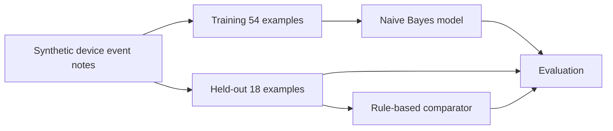

# Use Case — Synthetic Device Event Classification

**Domain:** AI Smart Energy Monitoring • **Status:** proof-of-concept, bukan keselamatan listrik.

## Masalah

Pembacaan meter listrik sintetis dapat dilengkapi **catatan kejadian perangkat** (misalnya "tegangan stabil", "pemakaian meningkat", atau "sensor offline"). Pada modul pertama, kita mempelajari supervised text classification dengan mengkategorikan catatan buatan menjadi:
- `normal`: kondisi pembacaan stabil yang dilaporkan simulator.
- `warning`: indikasi perubahan/peningkatan yang perlu pemeriksaan.
- `fault`: indikasi perangkat atau telemetri gagal.

Output adalah **label edukatif**, bukan penilaian profesional terhadap keamanan instalasi listrik dan bukan keputusan otomatis. Sistem produksi harus memakai aturan validasi dan prosedur teknis yang berbeda.

## Dataset dan kontrak

Input: CSV `text,label` berisi 54 training examples dan 18 held-out test examples, seluruhnya fiktif.

- Teks: 1–500 karakter, minimal satu token Unicode yang dapat dibaca.
- Label: `normal | warning | fault`.
- Inference: label atau `abstain` jika tidak ada token dikenali.
- JSON output: label, relative_score (bukan confidence terkalibrasi), dan explanatory note.

## Alur

## Acceptance criteria

1. Input invalid, labels salah, dan duplikasi ditolak.
2. Training dan test terpisah; normalized overlap ditolak.
3. Ada evaluasi accuracy, precision, recall, macro F1, confusion matrix dan abstention.
4. Rule-based comparator dan ML memakai held-out test sama.
5. Error tidak membocorkan data masukan yang sensitif.
6. Seluruh hasil harus dapat dijalankan dan dinilai secara lokal tanpa API eksternal.

## Hubungan dengan capstone

Week 01 memproses **catatan kejadian teks** untuk mempelajari ML. Capstone [AI Smart Energy Monitoring](../../projects/ai-energy-intelligence/README.md) nanti menggunakan **data numerik meter** (kWh per interval, arus dan tegangan) untuk mendeteksi kandidat anomali.

Jangan menyamakan dua use case itu. Text classification dan numerical anomaly detection membutuhkan data, model, dan evaluasi berbeda.

## Risiko

| Risiko | Kontrol pembelajaran |
| --- | --- |
| False normal / false fault | Human review; jangan melakukan aksi listrik otomatis |
| Data leakage | Train/test separated dan overlap checks |
| Miscalibrated relative score | Jangan sebut persentase kepastian |
| Input tidak dikenal | Explicit abstain |
| Privacy | Data sintetis, tanpa lokasi gedung/meter nyata |

Data dan hasil model **tidak digunakan untuk billing, kontrol daya, atau penilaian keselamatan**.
