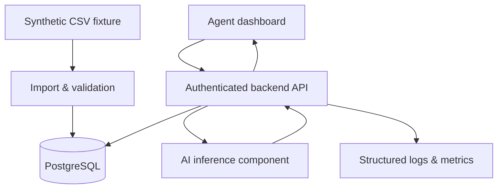

# Architecture — Proposed (Not Implemented)

## Trust boundaries

1. **Browser → API:** untrusted inputs, sessions, object permissions, CSRF considerations.
2. **Ingestion → database:** schema checks, size limits, idempotency and parameterized SQL.
3. **API → model:** strict request/response schemas, bounded requests, model provenance.
4. **Logs / telemetry:** redact message bodies and other sensitive data.

## Candidate decisions

- Choose local baseline classifier or external LLM via [ADR template](../../../docs/templates/adr-template.md).
- Design AI inference behind an interface; do not bind business logic to one provider.
- Model version must be recorded with each prediction for auditability.
- When inference fails, preserve input and provide actionable retry/error state.

These are plans; implementation and testing will come during learning weeks.
