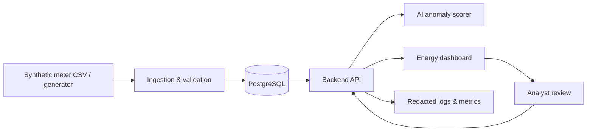

# Capstone — AI Smart Energy Monitoring

**Status:** spesifikasi pembelajaran saja; aplikasi frontend, backend, model numerik, database, dan deployment belum dibuat.

## Masalah yang diselesaikan

Sebuah gedung memiliki beberapa meter listrik virtual yang menghasilkan pembacaan konsumsi energi setiap interval. Data sensor dapat terlambat, duplikat, tidak valid, dan memperlihatkan lonjakan tidak biasa. Operator gedung perlu dashboard untuk memantau **data sintetis**, menandai **kandidat anomali**, dan mencatat keputusan peninjauan secara transparan.

> Dataset dan temuan dalam project ini adalah simulasi untuk latihan engineering. **Bukan sistem keselamatan listrik, billing, atau alat pengambil keputusan operasional otomatis.** Tidak ada klaim sensor fisik dipasang atau penghematan energi sudah dicapai.

## Tujuan pembelajaran

Menggabungkan dua kelompok kemampuan BNSP:
- **AI untuk Proses Data:** ingestion data meter, pemeriksaan schema/validity, integrasi model, instalasi, maintenance planning dan execution.
- **AI untuk Aplikasi Perangkat Lunak:** tool evaluation, data structures, desain UX/UI, entity relationship, software architecture, scalability, serta empat kompetensi AI bersama.

## Persona

- **Energy analyst:** menganalisis grafik kWh dan membandingkan anomali dengan konteks penggunaan.
- **Facility operator:** memeriksa alert, memberi catatan dan status review tanpa menganggap model sebagai instruksi keselamatan.
- **System maintainer:** memantau pipeline, kesehatan model, logs dan recovery.

## Data awal (semuanya sintetis)

| Field | Contoh | Validasi |
| --- | --- | --- |
| meter_id | MTR-001 | ID alat terdaftar pada site simulasi |
| interval_start_utc | 2026-01-01T00:00:00Z | Awal interval UTC, offset-aware dan aligned |\n| interval_minutes | 15 | Durasi 15 menit untuk schema v1 |
| energy_kwh | 1.42 | Angka finite dan tidak negatif; kebijakan nilai batas sesuai dataset |
| voltage_v | 229.5 | Angka finite, range simulasi didefinisikan di data dictionary |
| current_a | 6.2 | Angka finite dan tidak negatif |
| site_id | SITE-A | Scope akses data yang sah |
| source_event_id | E-00001 | Identitas unik per (site_id,meter_id) |

Catatan: schema v1 memiliki **8 kolom** menurut [kontrak domain](../../docs/architecture/energy-data-contract.md); `energy_kwh` diasumsikan **konsumsi per interval**, bukan nilai kumulatif meter. Jangan membandingkan dua definisi pengukuran yang berbeda tanpa normalisasi.

## Fitur wajib (rencana)

1. Generator dataset meter listrik sintetis dengan seed dan data dictionary.
2. Import CSV/API dengan schema checks, rejection report, dan ingestion idempotent.
3. Validasi data hilang, duplikat, timestamp gap, serta pembacaan di luar range yang didefinisikan.
4. Penyimpanan time-series dalam PostgreSQL dengan permission berbasis site.
5. Dashboard grafik kWh, perbandingan periode, kualitas data, dan filter meter.
6. AI **anomaly candidate detection** untuk interval penggunaan tidak biasa; bandingkan dengan baseline deterministik.
7. Penjelasan anomali: meter, waktu, nilai, model_version, dan kondisi kualitas data.
8. Human review: confirmed_anomaly / expected_variation / needs_investigation, beserta audit trail.
9. Safe fallback ketika model offline; **pembacaan valid tidak hilang** dan tidak dibuat alert palsu.
10. Automated tests, service health, safe logs, deployment lokal, backup dan restore rehearsal.

## Nonfunctional constraints

- **Security:** authentication, site/object-level authorization, API rate limits dan secure configuration.
- **Privacy:** meter/gedung/data semuanya fiktif. Tidak ada lokasi/alamat asli atau data penghuni.
- **Reliability:** stable event IDs, timeouts, idempotent retry, fallback manual review.
- **AI quality:** precision/recall/F1 untuk benchmark berlabel sintetis; jika unsupervised, gunakan evaluasi yang sesuai dan jangan klaim ground truth nyata.
- **Observability:** model version, job status, ingestion counts, validation rejects, P95 latency dan error rate.
- **Safety:** hasil anomali hanya informasi untuk operator, **bukan instruksi memutus aliran listrik atau melakukan tindakan teknis berbahaya**.

## Rencana arsitektur

## Delivery gates

| Tahap | Minggu | Evidence |
| --- | --- | --- |
| Data foundation | 03–04 | Data dictionary, import idempotent, reject/quality report |
| Full-stack | 05–10 | Algorithms, wireframes, UI, ERD, API, architecture + load-test plan |
| AI | 11–12 | Baseline vs model, anomaly API contract, failure tests, review workflow |
| Operations | 13–15 | Installation, monitoring, maintenance plan, restore/incident drill |
| Portfolio | 16 | Bukti kompetensi, demo, gap analysis |

**Modul 1** menyediakan latihan awal [klasifikasi teks kejadian perangkat sintetis](../../learning/week-01-ai-fundamentals/README.md). Itu bukan model numerik deteksi anomali; keduanya merupakan dua teknik AI berbeda.

Lihat [requirements](docs/requirements.md), [architecture](docs/architecture.md), dan [implementation plan](docs/implementation-plan.md).
