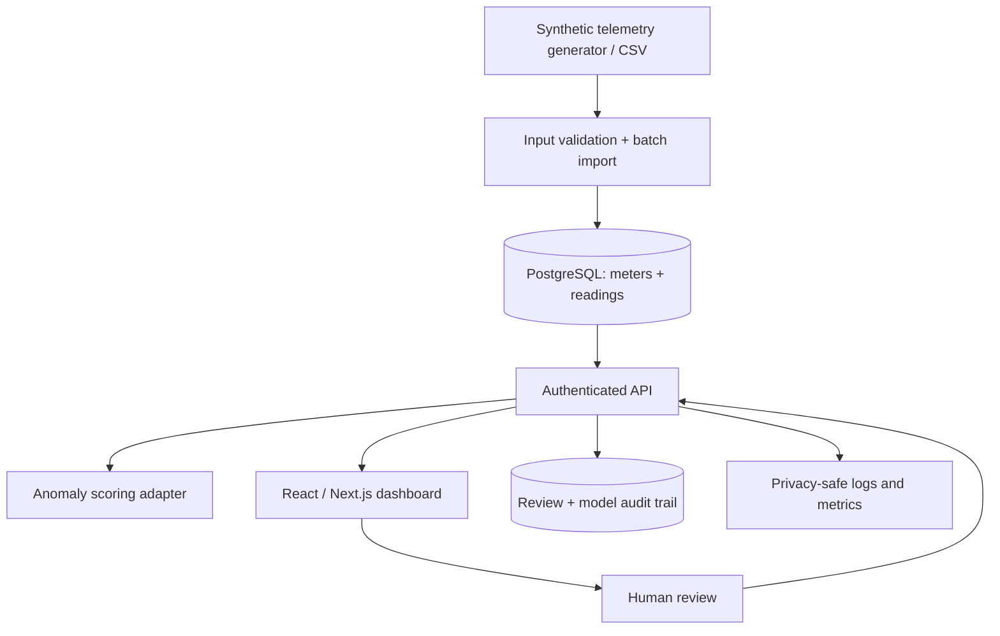

# Proposed Architecture — AI Smart Energy Monitoring

**Status:** design only; belum ada backend/frontend production maupun sensor deployment.

## Trust boundaries

1. **CSV → ingestion:** input tidak tepercaya. Validasi schema, file size, timestamp, finite numeric values, unit kWh dan event ID.
2. **UI → API:** server-side authN, per-site authZ, pagination, rate limit dan output encoding.
3. **API → anomaly scorer:** strict features/model_version, timeouts dan output schema; jangan menaruh provider secrets pada browser.
4. **API → DB:** parameterized SQL, transactions, foreign keys, unique `(site_id,meter_id,source_event_id)`.
5. **Logging/monitoring:** hindari data site sensitif; instrument latency, queue depth, errors dan review corrections.

## Model boundaries

Week 01 = **text classification of synthetic device-event notes** untuk belajar ML metrics dan error analysis. Week 11–12 = **numerical anomaly scoring of energy telemetry** untuk capstone. Keduanya tidak disamakan: anomaly detection memerlukan evaluasi berbeda dari supervised text classification.

## Data correctness

- `energy_kwh`: interval energy consumption, bukan power kW dan bukan cumulative reading.
- `interval_start_utc`: UTC, timezone-aware; `interval_minutes=15` untuk v1; hindari naive datetime dan asumsi pengukuran berdurasi sama.
- Pengukuran missing, duplicate, NaN, infinity, negative: reject/quarantine sesuai aturan.
- Uji leakage jika fitur masa depan dipakai untuk menilai periode sebelumnya.

## Failure strategy

- Gagal inferensi tidak berarti data meter hilang.
- Prediksi anomali merupakan **kandidat untuk review**, bukan keputusan keselamatan.
- Audit mempertahankan skor, versi model, timestamp review, dan keputusan manusia.

Lihat [schema tunggal](../../../docs/architecture/energy-data-contract.md) dan [threat model](../../../docs/architecture/threat-model.md). Tidak ada tindakan fisik otomatis dari hasil anomaly scoring.
